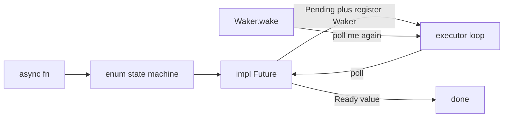

# Async Rust, Part I

Chat lessons turned into runnable binaries. This follows chapters 1–5 of [Async Rust: From Futures to Production](https://microsoft.github.io/RustTraining/async-book/ch00-introduction.html). The working style matches [Learning Rust With Entirely Too Many Linked Lists](https://rust-unofficial.github.io/too-many-lists/index.html): type the idea, run it, read the compiler.

Rust ships the `Future` trait. It does not ship an executor. `tokio` in `Cargo.toml` is a library for a later part. These lessons poll futures with a small `block_on` written in each binary.



## Lesson 1 — no runtime

Source: [Why Async is Different in Rust](https://microsoft.github.io/RustTraining/async-book/ch01-why-async-is-different-in-rust.html).

Code: [`src/bin/async_l1_lazy.rs`](../src/bin/async_l1_lazy.rs).

`async fn` returns a value that implements `Future`. Until something calls `poll`, the body does not run. Drop that value and the rest of the work never happens, because nothing else is holding it.

```bash
cargo run --bin async_l1_lazy
cargo run --bin async_l1_lazy -- --drive
```

The first command prints `main is done; hello() was never polled`. The second polls `hello` and prints `hello from async`.

Async earns its keep when the task is waiting on I/O. A tight CPU loop still belongs on a thread. [`src/bin/server.rs`](../src/bin/server.rs) already does that: `thread::spawn` gives each connection its own thread, and that thread blocks in `read`.

**Checkpoint.** Why does the first command omit `hello from async`?

## Lesson 2 — the `Future` trait

Source: [The Future Trait](https://microsoft.github.io/RustTraining/async-book/ch02-the-future-trait.html).

Code: [`src/bin/async_l2_countdown.rs`](../src/bin/async_l2_countdown.rs).

```rust
fn poll(self: Pin<&mut Self>, cx: &mut Context<'_>) -> Poll<Self::Output>;
```

`Poll::Ready(value)` means the work finished. `Poll::Pending` means not yet. Before returning `Pending`, the future must arrange for `cx.waker().wake()` to run later. That is the only signal a parking executor has. Skip it, and the task sleeps forever.

`Countdown` prints `3...`, `2...`, `1...`, then `liftoff`. Each incomplete poll calls `wake_by_ref` immediately. That is a busy wake, not a timer. A real timer registers the waker with the OS and returns `Pending` without waking yet.

`Pin` shows up in the signature here. Lesson 4 explains it. `Countdown` has a `u32` field, so it is `Unpin` and safe to move.

```bash
cargo run --bin async_l2_countdown
```

## Lesson 3 — a tiny executor

Source: [How Poll Works](https://microsoft.github.io/RustTraining/async-book/ch03-how-poll-works.html).

Code: [`src/bin/async_l3_executor.rs`](../src/bin/async_l3_executor.rs).

`block_on` pins the future, builds a `Waker` that unparks the current thread, and loops on `poll`. On `Pending` it calls `thread::park`. `park` is sticky: if `unpark` ran during `poll`, the next `park` returns at once.

A production runtime parks on epoll, kqueue, or io_uring instead of a thread waker you fire yourself.

Rules for every `poll`:

- Return immediately. Waiting belongs to the executor.
- Store the waker on every `Pending` path. The executor may pass a new one on the next poll.
- Recheck the real condition after storing the waker, so a wake cannot land in the gap and get lost.
- After `Ready`, the executor must not poll that future again.

```bash
cargo run --bin async_l3_executor
cargo run --bin async_l3_executor -- --hang
```

`--hang` is the broken countdown: it returns `Pending` and never calls `wake`. The process sits in `park`. Press Ctrl+C. Replacing `park` with `yield_now` would make this look fine, because the loop would poll again anyway.

**Checkpoint.** A waker tells the executor to poll this future again.

## Lesson 4 — `Pin`

Source: [Pin and Unpin](https://microsoft.github.io/RustTraining/async-book/ch04-pin-and-unpin.html).

Code: [`src/bin/async_l4_pin.rs`](../src/bin/async_l4_pin.rs).

`hold` keeps a reference to a local `String` across `.await`. The generated state machine stores both the `String` and the reference. Move the future and the reference still holds the old address. `Pin<&mut F>` is the promise that `F` stays there.

- `Countdown` is `Unpin`. `Pin::new(&mut countdown)` compiles.
- `async { 1 }` is `!Unpin`. `Pin::new` does not compile. The failing lines are commented in the binary. Uncomment them and read the error.
- `Box::pin(async { 1 })` and `std::pin::pin!(...)` compile. Moving the `Pin` wrapper copies a pointer. The future stays in its heap allocation or stack slot.

```bash
cargo run --bin async_l4_pin
```

`block_on` uses `Pin::new_unchecked`. That is sound only because the future is not moved after the pin. `Box::pin` and `pin!` are the safe tools.

## Lesson 5 — what `async fn` compiles to

Source: [The State Machine Reveal](https://microsoft.github.io/RustTraining/async-book/ch05-the-state-machine-reveal.html).

Code: [`src/bin/async_l5_state_machine.rs`](../src/bin/async_l5_state_machine.rs).

`.await` is a state boundary. The compiler builds an enum, one variant per await point, and implements `Future` for it. `FetchBoth` is that enum written out:

| Source reaches | Variant stores |
| --- | --- |
| the call, before the first await | `Start` |
| `http_get("/a").await` | `fut1` only |
| `http_get("/b").await` | `page1` and `fut2`. `fut1` is dropped at the transition |
| both pages ready | the formatted `String`, then `Done` |

The future's size is the largest variant. `sized_futures` prints the size of `async { 1 }` next to a future that holds a 4 KiB array across `.await`. `Box::pin` on a large inner future stores a pointer in the parent, so the parent stays small.

The hand-written `poll` uses `mem::replace` because `FetchBoth` is `Unpin`. Compiler-generated machines are `!Unpin` and use unsafe pin projection. This file does not copy that projection.

```bash
cargo run --bin async_l5_state_machine
```

**Exercise.** On paper, list the locals alive in `Start`, `WaitingFirst`, `WaitingSecond`, and `Done`, and match them to `fetch_both` in the file comment.

## After Part I

You can explain `Future`, `Poll`, `Waker`, and `Pin`, and why `cargo run --bin async_l1_lazy` prints nothing from the async body. Part II is a hand-built `join` and `select`, then Tokio, then an async accept loop next to `src/bin/server.rs`.
